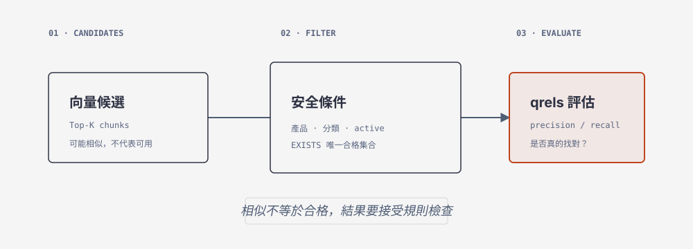

# 21 篩選與評估：相似段落不等於可用答案

> **概念**：先用產品、分類和有效狀態篩出合格資料，再用 qrels 評估搜尋結果是否找對。

[上一節](20-ann.md) · [下一節](22-consistency.md)



## 1. SQL 合格集合

```sql
SET @category=1;
SELECT c.chunk_id,c.document_id
FROM chunks c JOIN documents d ON d.document_id=c.document_id
WHERE d.status='active' AND EXISTS (
 SELECT 1 FROM product_documents pd JOIN products p ON p.product_id=pd.product_id
 WHERE pd.document_id=d.document_id AND p.status='active' AND (@category IS NULL OR p.category_id=@category)
) ORDER BY c.chunk_id;
```

分類 1 預期十個唯一 chunk；category 999 應零列。

## 2. 完整可執行 code section

```python
import os
from pathlib import Path
from embedding_course import load_artifact
from course_db import connect
from vector_course import recorded_query, search, evaluate

artifact = load_artifact(Path(os.environ.get("VECTOR_ARTIFACT", str(Path.home()/"mariadb-vectors.json"))))
with connect() as conn:
    for case_id in ("Q01", "Q08"):
        case, vector = recorded_query(artifact, case_id)
        rows = search(conn, vector, k=3, category_id=case["category_id"], mode="exact")
        print(case_id, [r["chunk_id"] for r in rows])
    print(evaluate(conn, artifact, k=3))
```

## 3. 固定 Agent prompt

> 使用 `/home/yillkid/mariadb-course-venv/bin/python`、`PYTHONPATH="$PWD"`，把完整程式原樣寫到 `/tmp/ch21_eval.py` 後執行；不得 placeholders、由排名反推 qrels、改 category 或讀 HackMD/repos。回報實際輸出、stderr 與 exit code；若資料庫不是 artifact baseline，保留真實錯誤。

## 4. 回到 artifact baseline（需要時）

如果 `evaluate()` 回報 `documents differ from artifact baseline`，先確認你要重置的是這個合成課程資料庫。不要讓 Agent 猜測或讀密碼；由教師確認後，使用已存在的 `course_editor.cnf` 執行：

```bash
mariadb --defaults-file="$HOME/mariadb-course-editor.cnf" \
  mariadb_workshop_2026 < demo/21-reset-baseline.sql

PYTHONPATH="$PWD" /home/yillkid/mariadb-course-venv/bin/python \
  vector_course.py ingest --artifact "$HOME/mariadb-vectors.json"
```

這個 reset 只重建 `documents`、`product_documents`、`chunks`、`course_meta` 與 `chunk_vectors` 的課程合成資料，不會 DROP table、不需要 root、不會列印秘密。完成後再執行本節 code 與 `evaluate`。

## 5. 執行與驗收

```bash
PYTHONPATH="$PWD" /home/yillkid/mariadb-course-venv/bin/python /tmp/ch21_eval.py; rc=$?; echo "exit_code=$rc"
python vector_course.py evaluate --artifact "$HOME/mariadb-vectors.json" --k 3; rc=$?; echo "exit_code=$rc"
```

```sql
SELECT COUNT(*) AS eligible_category_999 FROM chunks c JOIN documents d ON d.document_id=c.document_id
WHERE d.status='active' AND EXISTS (SELECT 1 FROM product_documents pd JOIN products p ON p.product_id=pd.product_id WHERE pd.document_id=d.document_id AND p.status='active' AND p.category_id=999);
```

Q03 relevant 可為空、Q04 可含 C003/C004；R 空時 precision／recall 為 NULL，另記 returned_on_no_answer。交件附 SQL、Q01/Q08 IDs、八題實際結果、退出碼與一個計算。
