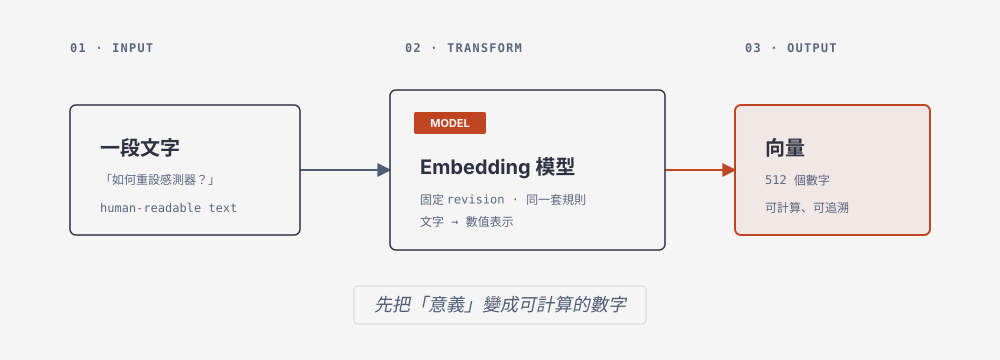

# 17 Embedding Workshop



## 概念
把文字轉成固定維度的向量，讓電腦能用數值表示文字意義；本練習使用 recorded artifact，不冒充 live encode。

## 完整程式
將主課 code section 原樣存成 `/tmp/ch17_embedding.py`（無 placeholders）：

```python
import os
from pathlib import Path
from embedding_course import load_artifact, validate_vector
p=Path(os.environ.get("VECTOR_ARTIFACT", str(Path.home()/"mariadb-vectors.json")))
a=load_artifact(p)
for c in a["chunks"]: validate_vector(c["embedding"])
assert all(len(c["embedding"])==512 for c in a["chunks"])
print("dimension =",len(a["chunks"][0]["embedding"]))
print("squared_norm =",sum(x*x for x in a["chunks"][0]["embedding"]))
print("chunks =",len(a["chunks"]),"queries =",len(a["queries"]))
print("model_revision =",a["metadata"]["model_revision"])
print("embedding_mode = recorded-artifact")
```

## Agent prompt
> 使用 `/home/yillkid/mariadb-course-venv/bin/python`、`PYTHONPATH="$PWD"`，寫入並執行 `/tmp/ch17_embedding.py`；不得 placeholders、改 revision 或讀 HackMD/repos。回報 stdout、stderr、exit code。

## 操作與驗收

```bash
mariadb mariadb_workshop_2026 -e "SELECT COUNT(*) documents FROM documents; SELECT COUNT(*) chunks FROM chunks; SELECT MIN(source_version),MAX(source_version) FROM chunks;"; rc=$?; echo "sql_exit_code=$rc"
PYTHONPATH="$PWD" /home/yillkid/mariadb-course-venv/bin/python /tmp/ch17_embedding.py; rc=$?; echo "exit_code=$rc"
```

實際記錄 8/16/version 1、dimension 512、norm 接近 1、revision 與 exit code；缺檔或 hash 錯誤保留非零結果。

## Output 對照表

| Output | 代表什麼 | 預期值 |
|---|---|---|
| `sql_exit_code` | SQL checkpoint 是否成功 | `0` |
| `exit_code` | Python 程式是否成功 | `0` |
| `dimension` | 每個向量的數字數量 | `512` |
| `squared_norm` | 向量長度平方；接近 1 代表已正規化 | 接近 `1.0` |
| `chunks` | 文字片段數量 | `16` |
| `queries` | 測試問題數量 | `8` |
| `model_revision` | 使用的模型版本 | 指定 revision |
| `embedding_mode` | 向量產生方式 | `recorded-artifact` |
