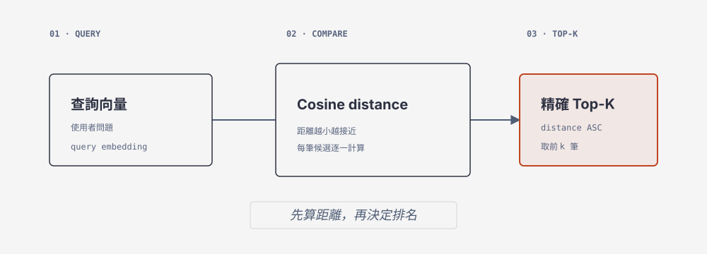

# 19 精確 Top-K Workshop



## 概念
計算查詢向量與文件向量的 cosine distance，依距離由近到遠找出精確 Top-K。

## 完整程式 `/tmp/ch19_ranking.py`
```python
import os
from pathlib import Path
from embedding_course import load_artifact
from course_db import connect
from vector_course import recorded_query, search
a=load_artifact(Path(os.environ.get("VECTOR_ARTIFACT",str(Path.home()/"mariadb-vectors.json"))))
case,v=recorded_query(a,"Q01")
with connect() as conn: rows=search(conn,v,k=3,category_id=case["category_id"],mode="exact",explain=False)
for r in rows: print(r["chunk_id"],r["distance"])
assert len({r["chunk_id"] for r in rows})==len(rows)
```

## Agent prompt
> 用 `/home/yillkid/mariadb-course-venv/bin/python`、`PYTHONPATH="$PWD"` 執行 `/tmp/ch19_ranking.py`；不得 placeholders、手動重排、改 qrels 或讀 HackMD/repos。回報實際 exit code。

```bash
PYTHONPATH="$PWD" /home/yillkid/mariadb-course-venv/bin/python /tmp/ch19_ranking.py; rc=$?; echo "exit_code=$rc"
python vector_course.py search --artifact "$HOME/mariadb-vectors.json" --case Q01 --mode exact --k 3 --explain; rc=$?; echo "search_exit_code=$rc"
```
保存 SQL 自我查詢、IDs/distance、EXPLAIN、原文與退出碼。
