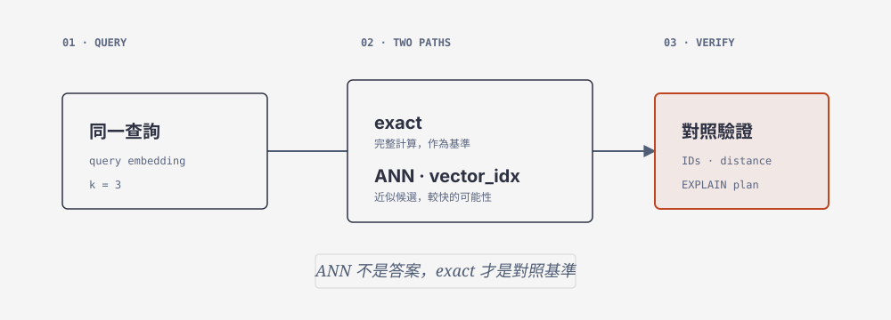

# 20 ANN Workshop



## 概念
VECTOR INDEX 可以提供 ANN 近似搜尋，但必須和 exact 結果及 EXPLAIN plan 對照；16 筆資料不能宣稱效能優勢。

## 完整程式 `/tmp/ch20_ann.py`
```python
import os
from pathlib import Path
from embedding_course import load_artifact
from course_db import connect
from vector_course import recorded_query, search
a=load_artifact(Path(os.environ.get("VECTOR_ARTIFACT",str(Path.home()/"mariadb-vectors.json"))))
case,v=recorded_query(a,"Q01")
with connect() as conn:
 exact=search(conn,v,k=3,category_id=case["category_id"],mode="exact",explain=False)
 ann=search(conn,v,k=3,category_id=case["category_id"],mode="ann",explain=False)
print("exact =",[(r["chunk_id"],r["distance"]) for r in exact]); print("ann =",[(r["chunk_id"],r["distance"]) for r in ann])
e={r["chunk_id"] for r in exact}; n={r["chunk_id"] for r in ann}; print("intersection_fraction =",len(e&n)/len(e) if e else None)
```

## Agent prompt
> 使用 `/home/yillkid/mariadb-course-venv/bin/python`、`PYTHONPATH="$PWD"`，將完整程式原樣寫入並執行 `/tmp/ch20_ann.py`。程式用 `explain=False` 取得 exact/ANN 結果；再用 `search --explain` 命令取得 plans，確認 ANN 使用 `vector_idx`，exact 不使用 `vector_idx`（exact 可能使用 `document_id`）。不得 placeholders、捏造 plan、改 query/k 或讀 HackMD/repos。回報每一步 stdout/stderr/實際 exit code。

```bash
PYTHONPATH="$PWD" /home/yillkid/mariadb-course-venv/bin/python /tmp/ch20_ann.py; rc=$?; echo "code_exit_code=$rc"
PYTHONPATH="$PWD" /home/yillkid/mariadb-course-venv/bin/python vector_course.py search --artifact "$HOME/mariadb-vectors.json" --case Q01 --mode exact --k 3 --explain; rc=$?; echo "exact_plan_exit_code=$rc"
PYTHONPATH="$PWD" /home/yillkid/mariadb-course-venv/bin/python vector_course.py search --artifact "$HOME/mariadb-vectors.json" --case Q01 --mode ann --k 3 --explain; rc=$?; echo "ann_plan_exit_code=$rc"
mariadb --defaults-file="$HOME/mariadb-course-editor.cnf" mariadb_workshop_2026 -e "SHOW INDEX FROM chunk_vectors WHERE Key_name='vector_idx';"; rc=$?; echo "sql_exit_code=$rc"
```
保留 plans、IDs、交集及 SQL；小資料不可宣稱效能。
